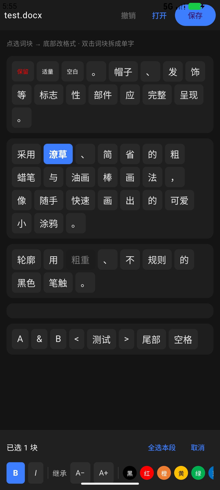
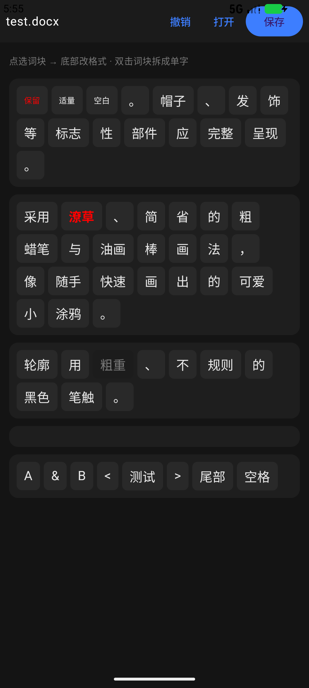
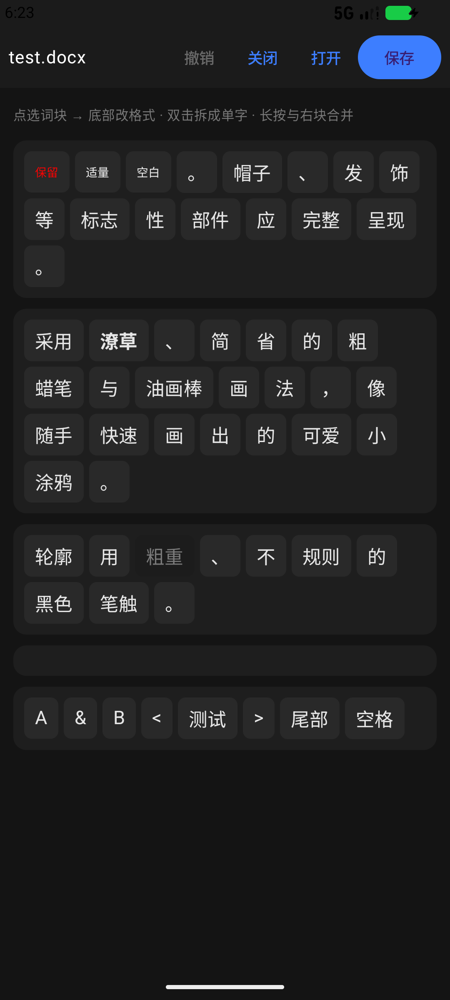
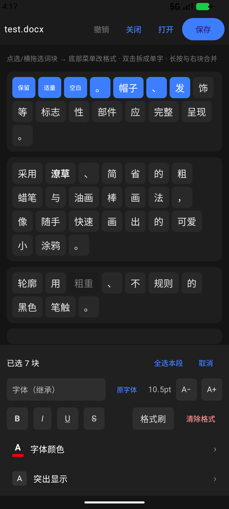
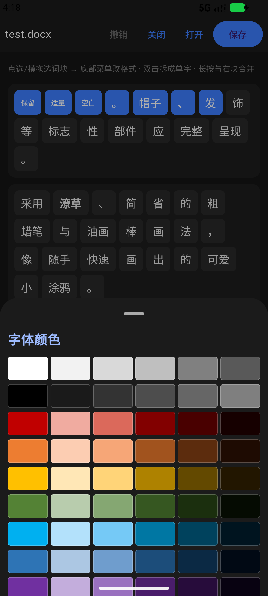

# ZhaZi Editor · 炸字编辑

[](https://github.com/zy2755/zhazi-editor/releases/latest)
[](app/src/test/java/com/zhazi/editor/EngineTest.kt)
[](#license)
[](https://github.com/ImranR98/Obtainium)

**English**: ZhaZi ("boom-chips") is an open-source Android editor for Word (.docx) files. Chinese sentences explode into tappable word chips — pick words by tapping instead of long-press dragging, then apply font, size and color from a bottom bar. Saving is surgical: only the runs you touched are rewritten, everything else (bookmarks, tables, images) is preserved byte-for-byte.

**中文**：把 Word 文档"炸"成一个个词块：点选词块即可快速修改字体、字号、颜色，告别手机上难用的长按拖拽选字。保存时只重写改动过的 run，书签、表格、图片等其余内容字节级原样保留，不重写、不毁文档。

| 词块流（原格式可见） | 点选词块 + 工具栏 | 应用红色后 | 格式刷连刷 | 长按合并块 | Word 式菜单 + 拖选 | 字体颜色色板 |
| --- | --- | --- | --- | --- | --- | --- |
|  |  |  |  |  |  |  |

以上为模拟器实拍：注意红色"保留"、加粗"潦草"、灰色受保护的"粗重"（含 tab 的 run 不可编辑）；
格式刷截图里"涂鸦"已被刷成源词块"保留"的红字+小字号。

## Install / 安装

- **GitHub Releases（推荐）**：下载 [最新 APK](https://github.com/zy2755/zhazi-editor/releases/latest)，Android 8.0+，通用包（arm64 / armv7 / x86_64）
- **Obtainium**：安装 [Obtainium](https://github.com/ImranR98/Obtainium) 后添加仓库 `zy2755/zhazi-editor`，之后发布新版本会自动提示更新
- **F-Droid**：上架材料已就绪（[fastlane/metadata](fastlane/metadata/android/com.zhazi.editor/)，含双语描述与图标），提交流程见下文 [F-Droid / IzzyOnDroid 上架](#f-droid--izzyondroid-上架)
- **从源码构建**：`./gradlew assembleDebug`（或 Android Studio 打开直接 Run）

## 功能（MVP）

- 打开 / 另存 .docx（系统文件选择器，默认只筛 docx，无需存储权限）；顶部"关闭"可回到首页
- 中文分词炸字（ICU 词典分词；双击词块可拆成单字；设备词典缺失时长汉字块自动降级为单字块）
- **点选或横向拖选**连续多块（跨 run 选择自动拆分 run），Word 式底部菜单批量应用：
  - 加粗 / 斜体 / 下划线 / 删除线
  - 字号 ±步进（显示当前值，如 10.5pt；"继承"表示未显式设置）
  - 字体颜色：Word 式主题色 10×6 网格 + 恢复原色
  - 突出显示：OOXML 15 命名色板 + 无高亮
  - 常用中英文字体 + 恢复原字体
  - 清除全部显式字符格式
- **格式刷**：选中源词块 → 点"格式刷" → 连续点目标词块应用同款格式（源没有的属性，目标也重置回继承）；再点格式刷退出
- **词块定制**：双击词块拆成单字；长按词块与右块合并（末块并左块）——分词不合直觉时的兜底
- 撤销（50 步）
- 词块直接显示该 run 当前的颜色 / 字号 / 加粗 / 斜体，所见即所选

## 构建要求

JDK 17 + Android SDK（platform 35）。Debug/Release 构建、签名配置、单元测试与常见问题见 **[BUILDING.md](BUILDING.md)**。

## 设计要点（给想改代码的你）

| 文件 | 职责 |
| --- | --- |
| `docx/XmlScanner.kt` | 带偏移量的轻量 XML 令牌扫描器 + 实体编解码 |
| `docx/DocxModel.kt` | 段落 / run 模型；不可理解的 run 一律标记"受保护" |
| `docx/RprOps.kt` | rPr 子元素的原样解析与按 OOXML 规范顺序的插入/删除 |
| `docx/DocxEditor.kt` | 格式补丁 → 拆 run → 逐个 splice 回 XML；docx zip 读写 |
| `docx/Segmenter.kt` | ICU 分词 → 词块区间（含强制拆分与长块降级） |
| `ui/Chips.kt` | 词块流渲染（颜色/字号/加粗直接反映在词块上） |
| `ui/FormatBar.kt` | 底部格式工具栏 |
| `MainActivity.kt` | 状态、SAF 文件读写、段落列表 |

安全策略：
- 只"理解" `w:p > w:r (rPr + t)` 的普通文本 run；表格、图片、超链接文本、
  含 tab/域的 run 一律受保护（灰色词块），编辑永不触碰它们的原始 XML
- 保存 = 原始 zip 逐条目复制 + 仅替换 `word/document.xml`；XML 中未被改动的
  字节（书签、proofErr、sectPr、样式引用……）全部原样保留
- rPr 新增标签按 CT_RPr 规范顺序插入，避免 Word 报"内容有问题"

## 单元测试

docx 引擎（`docx/` 包）是纯 Kotlin，单元测试跑在桌面 JVM 上：

```bash
./gradlew :app:testDebugUnitTest
```

覆盖：解析（段落/run/实体解码/tab 受保护）、分词（覆盖首尾、拆字、长块降级）、
格式化（段内、跨 run 拆分、保留原字号、清除格式、空补丁恒等、受保护 run 跳过、格式刷语义）、
词块定制（拆分/合并/受保护拒绝/选择清除）、
zip 回写（其余条目字节一致、输出 XML 可被标准解析器解析、可重新解析）。

## 从源码构建 Release

签名密钥生成、`local.properties` 配置、构建与签名验证的完整步骤见 **[BUILDING.md](BUILDING.md)** 第 6 节。注意：签名密钥放在仓库外并**务必备份**，更新包必须同签名。

## F-Droid / IzzyOnDroid 上架

本仓库已满足两家渠道的基础要求：依赖全部来自 Maven Central / Google 的开源库（无 GMS、无闭源 SDK）、带 gradle wrapper、源码即构建脚本、release 有 git tag（`v0.1.0`）。

- **IzzyOnDroid（快，推荐先走这条）**：它直接跟踪 GitHub Releases 里的 APK。提交入口已迁移至 Codeberg：到 [IzzyOnDroid/repodata issues](https://codeberg.org/IzzyOnDroid/repodata/issues) 按模板提收录申请（旧的 GitLab 仓库已停用）。本仓库自查已满足其 [收录政策](https://izzyondroid.org/docs/general/AppInclusionPolicy)：FOSS 许可 ✓、fastlane 元数据齐全 ✓、release 有 git tag 且与 versionName/versionCode 一致 ✓、APK 6.5MB（上限 30MB）✓、开发者自签名 ✓。
- **官方 F-Droid（慢，周期以月计）**：到 [F-Droid monitor](https://monitor.f-droid.org/) 提交打包请求（Request packaging），志愿者会基于 git tag 用官方 CI 从源码构建。仓库内的 [fastlane/metadata](fastlane/metadata/android/com.zhazi.editor/)（标题、双语描述、更新日志、512px 图标）就是为 F-Droid 的 fastlane 三件套准备的，收录后商店文案与图会直接取用。

注意：官方 F-Droid 从源码构建时不会用你的签名 keystore，而是 F-Droid 自己重签——与 GitHub Releases 的 APK 签名不同，两者不能互相覆盖安装，属正常现象。

## 无障碍调试入口（仅 debug 构建）

```bash
# 把文档放进应用私有目录后直接启动加载（跳过文件选择器，供自动化测试）
adb push 文档.docx /data/local/tmp/t.docx
adb shell run-as com.zhazi.editor sh -c 'mkdir -p files && cp /data/local/tmp/t.docx files/t.docx'
adb shell am start -n com.zhazi.editor/.MainActivity --es debug_path t.docx
```

正式入口：应用内"打开"，或系统文件管理器里用"打开方式 → 炸字编辑"（已注册 ACTION_VIEW）。

## 当前限制（下个迭代的方向）

- 不支持修改文本内容本身（只做格式化）；不支持表格内编辑、页眉页脚、样式表
- 词块外观不反映文档字体（设备上缺少宋体等字体文件），字体名只在底部菜单中显示；未改动的 run 字体永远字节级不变
- 段落样式（样式表继承）不解析，"继承"显示的是"无显式设置"；旧版 .doc 格式暂不支持，请先另存为 .docx
- 词块视图不分页、不显示图片；`w:sdt` 内容控件内的段落不显示
- 分词结果偶与直觉不符 → 双击拆字 / 长按合并兜底

## License

双许可，任选其一：[MIT](LICENSE-MIT) 或 [Apache-2.0](LICENSE-APACHE)。
Dual-licensed under your choice of the [MIT](LICENSE-MIT) or [Apache-2.0](LICENSE-APACHE) license.
