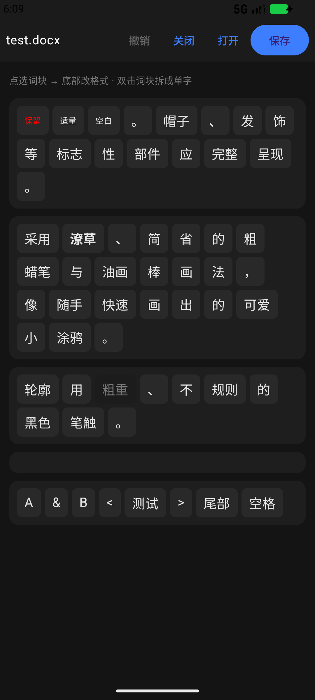
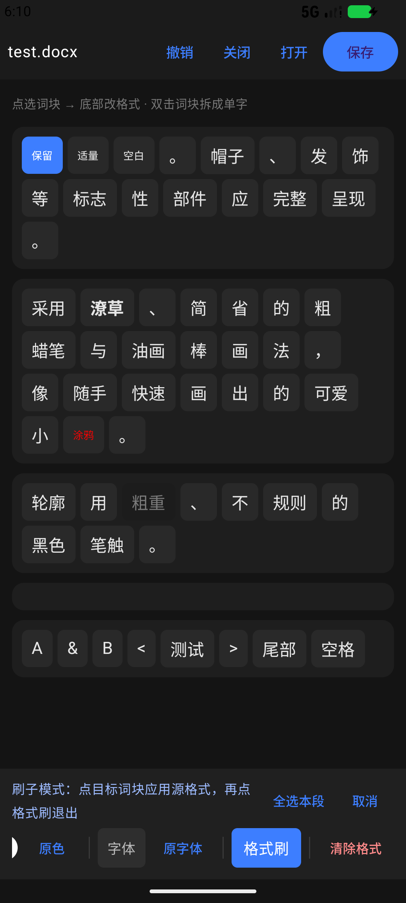

# 炸字编辑（ZhaZi Editor）

把 Word 文档"炸"成一个个词块：**点选词块，直接改字体、字号、颜色**——
用"炸字"交互取代手机上难用的长按拖拽选字。

核心思路：文档打开后，正文按中文分词炸开成词块流（灰色 = 不可编辑，蓝色 = 已选中），
点选若干词块后，底部工具栏即可套用格式；保存时只把改动过的 `<w:r>` 元素
外科手术式地写回原 XML，文档其余部分**字节级原样保留**，不重写、不毁文档。

| 词块流（原格式可见） | 点选词块 + 工具栏 | 应用红色后 | 格式刷连刷 | 长按合并块 |
| --- | --- | --- | --- | --- |
|  |  |  |  |  |

以上为模拟器实拍：注意红色"保留"、加粗"潦草"、灰色受保护的"粗重"（含 tab 的 run 不可编辑）；
格式刷截图里"涂鸦"已被刷成源词块"保留"的红字+小字号。

## 功能（MVP）

- 打开 / 另存 .docx（系统文件选择器，无需存储权限）
- 中文分词炸字（ICU 词典分词；双击词块可拆成单字；设备词典缺失时长汉字块自动降级为单字块）
- 点选多块（跨 run 选择自动拆分 run），批量应用：
  - 加粗 / 斜体
  - 字号 ±2 半磅步进（显示当前值，"继承"表示未显式设置）
  - 9 色调色板 + 恢复原色
  - 常用中英文字体 + 恢复原字体
  - 清除全部显式字符格式
- **格式刷**：选中源词块 → 点"格式刷" → 连续点目标词块应用同款格式（源没有的属性，目标也重置回继承）；再点格式刷退出
- **词块定制**：双击词块拆成单字；长按词块与右块合并（末块并左块）——分词不合直觉时的兜底
- 关闭文档回到首页（顶部"关闭"）
- 撤销（50 步）
- 词块直接显示该 run 当前的颜色 / 字号 / 加粗 / 斜体，所见即所选

## 构建

要求：JDK 17 + Android SDK（platform 35）。

```bash
./gradlew assembleDebug        # 产物：app/build/outputs/apk/debug/app-debug.apk
```

或用 Android Studio 打开本目录直接 Run。

`settings.gradle.kts` 里已配置阿里云 Maven 镜像（国内网络友好），
可安装到手机试用的示例文档在 `sample/示例.docx`。

## 设计要点（给想改代码的你）

| 文件 | 职责 |
| --- | --- |
| `docx/XmlScanner.kt` | 带偏移量的轻量 XML 令牌扫描器 + 实体编解码 |
| `docx/DocxModel.kt` | 段落 / run 模型；不可理解的 run 一律标记"受保护" |
| `docx/RprOps.kt` | rPr 子元素的原样解析与按 OOXML 规范顺序的插入/删除 |
| `docx/DocxEditor.kt` | 格式补丁 → 拆 run → 逐个 splice 回 XML；docx zip 读写 |
| `docx/Segmenter.kt` | ICU 分词 → 词块区间（含强制拆分） |
| `ui/Chips.kt` | 词块流渲染（颜色/字号/加粗直接反映在词块上） |
| `ui/FormatBar.kt` | 底部格式工具栏 |
| `MainActivity.kt` | 状态、SAF 文件读写、段落列表 |

安全策略：
- 只"理解" `w:p > w:r (rPr + t)` 的普通文本 run；表格、图片、超链接文本、
  含 tab/域的 run 一律受保护（灰色词块），编辑永不触碰它们的原始 XML
- 保存 = 原始 zip 逐条目复制 + 仅替换 `word/document.xml`；XML 中未被改动的
  字节（书签、proofErr、sectPr、样式引用……）全部原样保留
- rPr 新增标签按 CT_RPr 规范顺序插入，避免 Word 报"内容有问题"

## 当前限制（下个迭代的方向）

- 不支持修改文本内容本身（只做格式化）；不支持表格内编辑、页眉页脚、样式表
- 段落样式（样式表继承）不解析，"继承"显示的是"无显式设置"
- 词块视图不分页、不显示图片；`w:sdt` 内容控件内的段落不显示
- 分词结果偶与直觉不符 → 双击拆字 / 长按合并兜底
- 未做"选中所有同样式文字""格式刷"等进阶批量操作

## 单元测试

docx 引擎（`docx/` 包）是纯 Kotlin，单元测试跑在桌面 JVM 上：

```bash
./gradlew :app:testDebugUnitTest
```

## 无障碍调试入口（仅 debug 构建）

```bash
# 把文档放进应用私有目录后直接启动加载（跳过文件选择器，供自动化测试）
adb push 文档.docx /data/local/tmp/t.docx
adb shell run-as com.zhazi.editor sh -c 'mkdir -p files && cp /data/local/tmp/t.docx files/t.docx'
adb shell am start -n com.zhazi.editor/.MainActivity --es debug_path t.docx
```

正式入口：应用内"打开"，或系统文件管理器里用"打开方式 → 炸字编辑"（已注册 ACTION_VIEW）。

覆盖：解析（段落/run/实体解码/tab 受保护）、分词（覆盖首尾、拆字、长块降级）、
格式化（段内、跨 run 拆分、保留原字号、清除格式、空补丁恒等、受保护 run 跳过）、
zip 回写（其余条目字节一致、输出 XML 可被标准解析器解析、可重新解析）。
